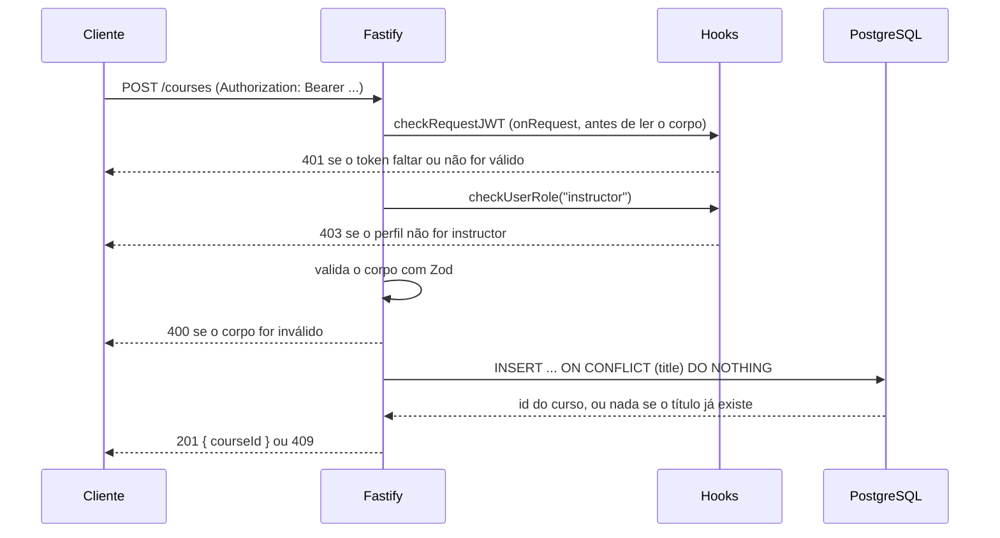

# API de Cursos

[](https://github.com/Ricardoleaom/apinode/actions/workflows/ci.yml)

API REST para gerenciamento de cursos com autenticação JWT e controle de
acesso por perfil (`student` e `instructor`). Feita com Fastify, TypeScript,
Drizzle ORM e PostgreSQL, documentada em OpenAPI e coberta por testes de
integração que rodam contra um banco real.

## Stack

| Camada       | Tecnologia                                                                              |
| ------------ | --------------------------------------------------------------------------------------- |
| HTTP         | [Fastify 5](https://fastify.dev/) com [Zod](https://zod.dev/) validando entrada e saída |
| Banco        | PostgreSQL 17 com [Drizzle ORM](https://orm.drizzle.team/) e migrações versionadas      |
| Autenticação | JWT (HS256) e senhas com [argon2](https://github.com/ranisalt/node-argon2)              |
| Documentação | OpenAPI gerado das rotas, navegável com [Scalar](https://scalar.com/) em `/docs`        |
| Testes       | [Vitest](https://vitest.dev/) e Supertest contra PostgreSQL                             |
| Entrega      | Docker multi-stage, Docker Compose e GitHub Actions                                     |

O TypeScript roda direto no Node (type stripping), sem etapa de build.

## Endpoints

| Método | Rota           | Acesso       | O que faz                                                                                                                 |
| ------ | -------------- | ------------ | ------------------------------------------------------------------------------------------------------------------------- |
| `POST` | `/sessions`    | público      | Login com e-mail e senha; devolve um JWT válido por 1 hora                                                                |
| `POST` | `/courses`     | `instructor` | Cria um curso; `409` se o título já existe                                                                                |
| `GET`  | `/courses`     | `instructor` | Lista cursos com busca por título (`search`), ordenação (`orderBy`), paginação de 10 itens (`page`) e total de matrículas |
| `GET`  | `/courses/:id` | autenticado  | Busca um curso pelo ID                                                                                                    |
| `GET`  | `/health`      | público      | Confirma que a API está no ar e alcança o banco                                                                           |

Rotas protegidas esperam o cabeçalho `Authorization: Bearer <token>`.
A documentação interativa fica em <http://localhost:3333/docs>, e o contrato
OpenAPI em `/docs/openapi.json`.

| Status | Quando                                                                        |
| ------ | ----------------------------------------------------------------------------- |
| `400`  | Corpo, query ou parâmetro inválido (a resposta lista cada campo com problema) |
| `401`  | Token ausente, inválido, expirado ou credenciais incorretas                   |
| `403`  | Usuário autenticado sem o perfil exigido                                      |
| `404`  | Curso ou rota inexistente                                                     |
| `409`  | Título de curso já cadastrado                                                 |

## Fluxo de uma requisição protegida



## Decisões de segurança

- **Senhas com argon2**, nunca armazenadas em texto.
- **JWT com algoritmo fixo** na verificação (`HS256`), o que fecha a porta
  para ataques de troca de algoritmo. O conteúdo do token também é validado
  com Zod antes de chegar às rotas.
- **O login não revela quais e-mails existem**: e-mail inexistente e senha
  errada recebem a mesma resposta, e o hash é verificado nos dois casos para
  que o tempo de resposta também não denuncie.
- **Autenticação antes de tudo**: os hooks rodam em `onRequest`, então uma
  requisição sem token é recusada antes de o corpo ser lido ou validado.
- **401 e 403 separados**: um diz "quem é você?", o outro "você não pode".
- **Configuração validada na inicialização**: a API não sobe sem
  `DATABASE_URL` ou com um `JWT_SECRET` curto (mínimo de 32 caracteres).
- **Erros inesperados vão para o log**; o cliente recebe só uma mensagem
  genérica, sem stack trace nem detalhes do banco.
- **Título único garantido pelo banco** (`ON CONFLICT`), sem consulta prévia
  e sem condição de corrida entre duas requisições simultâneas.
- **Imagem Docker** só com dependências de produção, rodando como usuário
  sem privilégios e com health check.

## Como rodar

Requisitos: Docker com Compose e, para desenvolver, Node.js 22.18 ou mais
recente.

### Tudo em containers

```sh
cp .env.example .env
docker compose up --build
```

O Compose sobe o PostgreSQL, aplica as migrações e inicia a API em
<http://localhost:3333>. Para ter usuários de demonstração, rode o seed a
partir da sua máquina: `npm ci && npm run db:seed`.

### Desenvolvimento

```sh
cp .env.example .env
docker compose up -d db   # PostgreSQL com os bancos desafio e desafio_test
npm ci
npm run db:migrate
npm run db:seed
npm run dev               # recarrega a cada alteração
```

O seed cria duas contas de demonstração, ambas com a senha `123456`:

| E-mail                  | Perfil       |
| ----------------------- | ------------ |
| `instrutor@exemplo.com` | `instructor` |
| `aluno@exemplo.com`     | `student`    |

O arquivo [`requisicoes.http`](requisicoes.http) tem o fluxo completo (login,
criação, listagem e busca) pronto para a extensão REST Client do VS Code.

## Testes

```sh
docker compose up -d db
npm test
npm run test:coverage
```

Os testes sobem a aplicação em memória e fazem requisições HTTP reais contra
o banco `desafio_test`. As migrações rodam automaticamente antes da suíte, e
cada teste cria os próprios dados com identificadores únicos, então os
arquivos rodam em paralelo sem precisar limpar o banco entre eles. Para usar
outro banco, defina `TEST_DATABASE_URL`.

Cobrem login (sucesso, senha errada, e-mail inexistente e validação),
autenticação e autorização em cada rota (sem token, token sem `Bearer`,
token forjado, perfil errado), conflito de título, contagem de matrículas e
paginação sem itens repetidos nem pulados.

O [CI](.github/workflows/ci.yml) roda em todo push e pull request: typecheck
e testes contra um PostgreSQL de serviço e, em paralelo, constrói a imagem,
sobe a stack com o Compose e faz um smoke test na API.

## Scripts

| Script                  | O que faz                                               |
| ----------------------- | ------------------------------------------------------- |
| `npm run dev`           | API em modo desenvolvimento, com reload e logs legíveis |
| `npm start`             | API em modo produção                                    |
| `npm run typecheck`     | Checagem de tipos com o TypeScript                      |
| `npm test`              | Suíte de testes                                         |
| `npm run test:coverage` | Testes com relatório de cobertura                       |
| `npm run db:generate`   | Gera uma migração a partir do schema                    |
| `npm run db:migrate`    | Aplica as migrações pendentes                           |
| `npm run db:seed`       | Popula o banco com dados de demonstração                |
| `npm run db:studio`     | Abre o Drizzle Studio                                   |

## Estrutura

```
src/
├── app.ts                  # instância do Fastify, OpenAPI e tratamento de erros
├── server.ts               # inicialização e desligamento gracioso
├── env.ts                  # variáveis de ambiente validadas com Zod
├── database/
│   ├── schema.ts           # tabelas users, courses e enrollments
│   ├── client.ts
│   ├── migrate.ts
│   └── seed.ts
├── routes/
│   ├── hooks/              # autenticação (JWT) e autorização (perfil)
│   ├── login.ts
│   ├── create-courses.ts
│   ├── get-courses.ts
│   ├── get-courses-by-id.ts
│   ├── health.ts
│   └── *.test.ts
└── tests/                  # factories e configuração do banco de testes
drizzle/                    # migrações SQL geradas pelo drizzle-kit
```

## Próximos passos

- Limite de tentativas no `/sessions` contra força bruta.
- Refresh token e revogação de sessão.
- Endpoints de matrícula para o perfil `student`.
